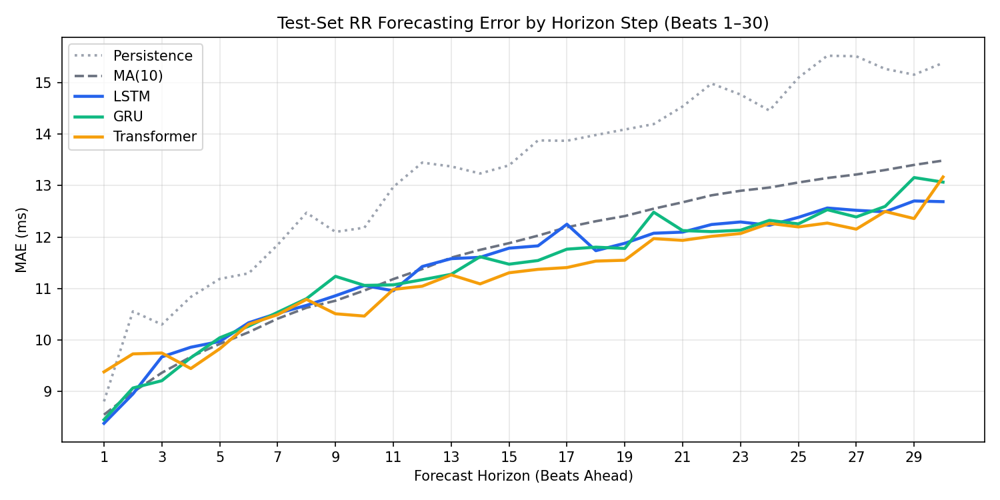
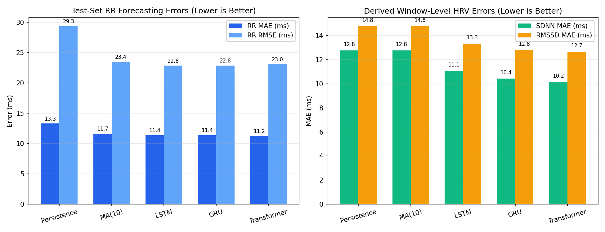
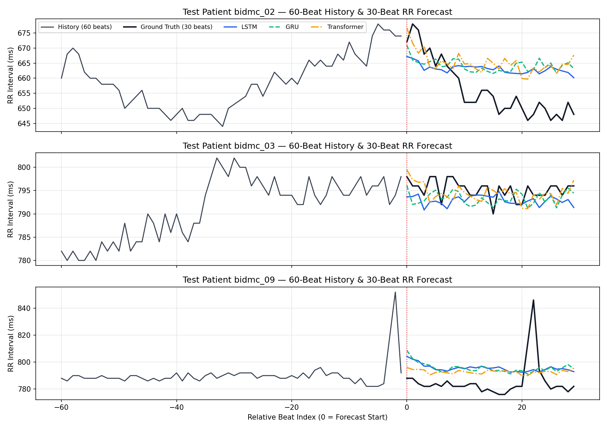
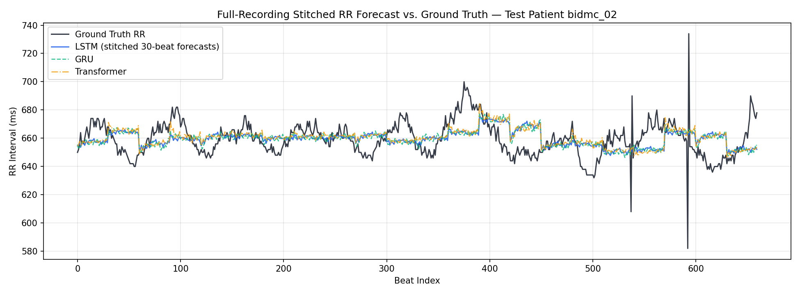

# RR-HRV Forecast Studio

An end-to-end deep learning benchmark and live inference web application comparing **LSTM**, **GRU**, and **Transformer** architectures for beat-to-beat **RR-interval forecasting** and **Heart Rate Variability (HRV)** derivation on ICU ECG recordings from the **BIDMC PPG and Respiration Dataset**.

## Pipeline Overview

1. **ECG Extraction & Upsampling (`src/extract_rr.py`):** Loads Lead II ECG from all 53 BIDMC recordings (8 minutes each, verified at 125 Hz), upsamples to **500 Hz** via cubic spline interpolation (2 ms temporal resolution), handles inverted leads, detects R-peaks with `neurokit2`, and interpolates ectopic/artifact intervals (>20% local median deviation or outside 300–2000 ms).
2. **Quality Control & Leak-Free Splits (`src/dataset.py`):** Excludes 6 high-artifact recordings (>20% corrected beats), retaining **47 clean patients** split strictly patient-wise into **33 Train / 7 Val / 7 Test** (20,435 / 4,876 / 4,136 sliding windows). Standardization (`mean = 677.03 ms`, `std = 106.23 ms`) is fit exclusively on training patients.
3. **Comparable Model Architectures (`src/models.py`, `src/train.py`):** All three sequence models forecast the **next 30 beats** from a **60-beat lookback** using matched parameter budgets (~110k–118k parameters), internal window-mean centering, Huber loss, AdamW, and early stopping on an NVIDIA RTX 4060 GPU.
4. **RR & HRV Evaluation (`src/evaluate.py`):** Evaluates models against naive baselines (`Persistence` and `MA(10)`) across 4,136 unseen test windows for point forecasting and derived time/frequency-domain HRV (Mean HR, SDNN, RMSSD, pNN50, and stitched full-recording LF/HF ratio).
5. **Interactive Web Dashboard (`app.py`, `static/index.html`):** FastAPI + Chart.js studio running live GPU inference with a beat-level patient scrubber, benchmark explorer, and custom 60-beat RR sandbox.

## Test-Set Results (7 Unseen Patients, 4,136 Windows)

### Table 1: RR-Interval Forecasting Performance

| Model | Params | Train Time (s) | Infer Time (ms) | RR MAE (ms) | RR RMSE (ms) | RR MAPE (%) |
| :--- | ---: | ---: | ---: | ---: | ---: | ---: |
| Persistence | 0 | 0.00 | 0.65 | 13.29 | 29.33 | 1.85 |
| MA(10) | 0 | 0.00 | 1.09 | 11.65 | 23.44 | 1.63 |
| **LSTM** | 115,614 | 24.02 | 507.43 | 11.39 | **22.82** | 1.59 |
| **GRU** | 118,190 | **22.36** | **136.70** | 11.37 | 22.84 | 1.59 |
| **Transformer** | **110,430** | 45.51 | 261.87 | **11.24** | 23.03 | **1.57** |

### Table 2: Derived HRV Accuracy

| Model | Win HR MAE (bpm) | Win SDNN MAE (ms) | Win RMSSD MAE (ms) | Win pNN50 MAE (%) | Full SDNN MAE (ms) | Full RMSSD MAE (ms) | Full LF/HF MAE |
| :--- | ---: | ---: | ---: | ---: | ---: | ---: | ---: |
| Persistence | 1.20 | 12.77 | 14.78 | 5.23 | 4.73 | 15.82 | 3.23 |
| MA(10) | 0.93 | 12.77 | 14.78 | 5.23 | 6.87 | 17.24 | 3.23 |
| **LSTM** | 0.87 | 11.07 | 13.33 | 5.23 | 9.73 | 17.18 | 2.34 |
| **GRU** | **0.86** | 10.43 | 12.80 | 5.23 | 9.40 | 16.52 | **1.33** |
| **Transformer** | 0.88 | **10.15** | **12.68** | 5.23 | 9.13 | **15.87** | 1.43 |

### Key Findings

- **Transformer** achieved the lowest test RR MAE (**11.24 ms**), lowest MAPE (**1.57%**), and best 30-beat SDNN (**10.15 ms**) and RMSSD (**12.68 ms**) accuracy with the fewest parameters (110,430), at ~2x the training time of recurrent models.
- **GRU** delivered the best accuracy-to-efficiency ratio: fastest training (**22.36 s**), lowest heart-rate MAE (**0.86 bpm**), and best stitched frequency-domain autonomic balance (**LF/HF MAE = 1.33**, a ~59% reduction vs. baseline).
- **LSTM** achieved the lowest RR RMSE (**22.82 ms**), indicating slightly stronger robustness to large outlier beats.

## Diagnostic Visualizations

| Horizon Error (Beats 1–30) | Model Error Comparison |
| :---: | :---: |
|  |  |

| Sample 30-Beat Forecasts | Stitched Full-Recording Tachogram |
| :---: | :---: |
|  |  |

## Quick Start

### 1. Environment Setup
```bash
conda create -n hrv_forecast python=3.10 -y
conda activate hrv_forecast
pip install torch --index-url [https://download.pytorch.org/whl/cu124](https://download.pytorch.org/whl/cu124)
pip install -r requirements.txt